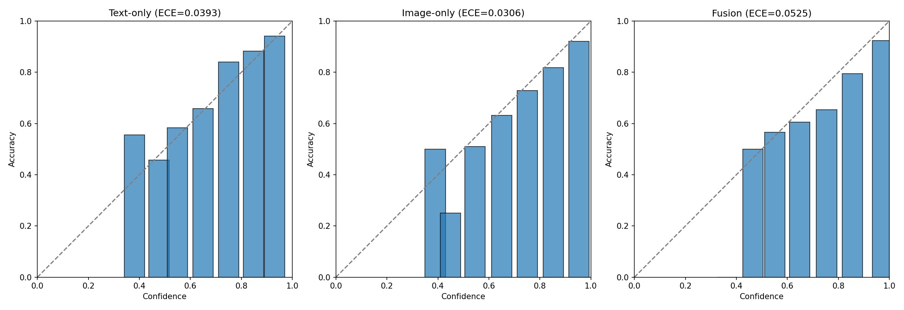
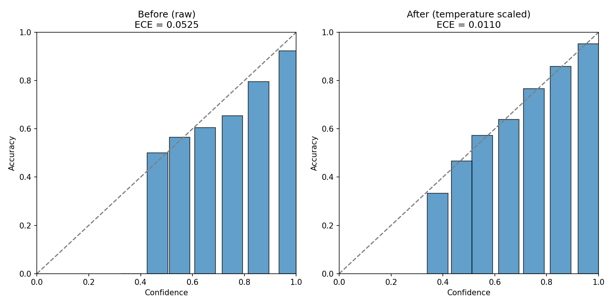
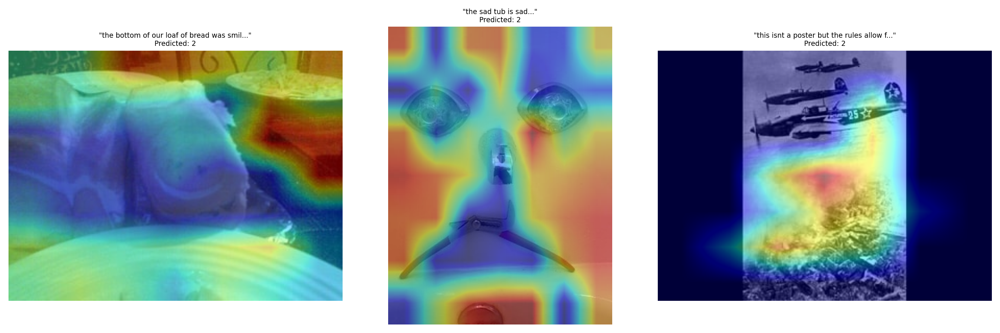

# Multimodal Misinformation Detection with Confidence Calibration

A misinformation classifier for social-media-style posts (caption + image) that goes beyond accuracy to ask a different question: **can the model's confidence in its own predictions actually be trusted?**

**[Live Demo](#)** &nbsp;|&nbsp; **[Companion project: MAMI Misogyny Detector](#)**

---

## Why this project exists

Most classifiers are evaluated on one axis: is the prediction correct? This project evaluates a second, usually-ignored axis: **when the model says it's 95% confident, is it actually right 95% of the time?** That property is called *calibration*, and it's independent of accuracy — a highly accurate model can still be badly calibrated, which matters enormously if its outputs are ever used to inform real decisions (e.g. flagging content for human review).

This project builds a multimodal (text + image) misinformation classifier on the [Fakeddit](https://github.com/entitize/Fakeddit) dataset, deliberately investigates where and why its confidence is unreliable, and applies a standard fix — then uses explainability tooling to understand what's actually driving its remaining mistakes.

## Key findings

- **The best-performing model is the worst-calibrated one.** A fusion model combining RoBERTa (text) and CLIP (image) embeddings outperformed both individual modalities on every accuracy metric — but had the *highest* calibration error (ECE) of the three, i.e. it was the most systematically overconfident.
- **Calibration failures aren't uniform.** Per-class analysis found two distinct failure modes: one class was miscalibrated due to limited training data; another was miscalibrated because the model was genuinely struggling with it while still reporting high confidence.
- **The model almost never signals honest uncertainty when wrong.** Of all misclassified test examples, only ~1% came with genuinely low confidence — meaning a human reviewer using confidence as a filter would catch almost none of the model's actual errors.
- **Temperature scaling reduced overall calibration error by 79%**, with an explicitly-acknowledged limitation: a single global correction can't perfectly fix every class simultaneously (one class's calibration slightly worsened while the other two improved substantially).
- **Grad-CAM, adapted for a Vision Transformer, surfaced qualitatively different failure types** on the model's worst mistakes — including at least one case that looks more like *dataset label noise* than a model error, tying back to a "disagreement as signal, not noise" theme that runs through this project and its companion, MAMI.
- **A live demo test surfaced a further, fully out-of-sample failure case.** An ordinary, unambiguous photo of two dogs — held out from every stage of this project, not just the test split — was confidently (97%) misclassified as "Misleading." Testing two different captions on the same image (including one deliberately stripped of emotionally-loaded language) ruled out a caption-wording explanation; Grad-CAM showed the model's attention concentrated correctly on the dog's face, pointing instead to a learned association between close-up animal-face framing and the Misleading class — plausibly inherited from the dataset's pareidolia/anthropomorphism-heavy Misleading subreddits. See [Case Studies](#case-studies) below.

## Results summary

All models evaluated on the same held-out test set (n=2,986):

| Model | Accuracy | Macro-F1 | AUROC | ECE (lower = better) |
|---|---|---|---|---|
| Text-only (RoBERTa) | 0.7415 | 0.6707 | 0.8705 | 0.0393 |
| Image-only (CLIP) | 0.7656 | 0.7838 | 0.8928 | 0.0306 |
| **Fusion (text + image)** | **0.8282** | **0.8419** | **0.9355** | 0.0525 |
| Fusion + temperature scaling | 0.8282 | 0.8419 | 0.9355 | **0.0110** |

*(Accuracy/F1/AUROC are identical before and after calibration by design — temperature scaling only rescales confidence, it never changes predictions.)*

## Case studies

Four concrete failure cases, investigated with Grad-CAM (adapted for CLIP's Vision Transformer — see [Methodology](#project-structure--methodology) for how):

**1. Bread photo — likely shortcut learning.** Caption implies a face-like pattern in the bread itself; the model's attention instead concentrated on a background plate, suggesting it may be keying off spurious background cues rather than the described content.

**2. "Sad tub" pareidolia photo — likely label noise, not a model error.** Attention spread sensibly across the actual face-like pattern (eyes, faucet "nose," razor "mouth"). Given Fakeddit's Misleading label is drawn largely from pareidolia-style subreddits, the model's prediction may better reflect the dataset's own labeling convention than this specific row's ground-truth label does — a concrete instance of the "disagreement as signal, not noise" theme running through this project.

**3. WWII propaganda poster — plausible but imperfect reasoning.** Attention concentrated on smoke/explosion in the image rather than the poster-style stylistic cues a human would likely use to recognize satire/propaganda framing.

**4. "This smiling dog" — a fully out-of-sample failure, found via live testing, not cherry-picked.** While testing the deployed demo, an ordinary photo of two dogs — never used in training, validation, or evaluation at any stage of this project — was confidently (97%) misclassified as Misleading.
   - First hypothesis (caption wording) was tested and ruled out: re-running the same image with a neutral caption stripped of any emotionally-loaded language barely changed the confidence (96.9% → 97.3%).
   - Grad-CAM then showed the model's attention correctly and specifically concentrated on the dog's face — not scattered, not on the background.
   - Best-supported explanation: the model may have learned an association between **close-up animal-face framing** itself and the Misleading class, likely inherited from Fakeddit's pareidolia/anthropomorphism-heavy Misleading-labeled subreddits, independent of the actual caption paired with the image.
   - This case is a useful demonstration of hypothesis testing, not just pattern-spotting: a first plausible guess was tested directly and discarded in favor of a better-supported explanation once the evidence didn't fit.

## Try it yourself

The live demo takes a caption + image and returns a prediction with **calibrated** confidence (not the raw, overconfident score):

**→ [Launch the demo](#)** *(link to be added once deployed)*

## Project structure & methodology

The project was built in five stages, each a self-contained, reproducible notebook:

| Stage | Notebook | What it does |
|---|---|---|
| 1 | `01_data_prep_and_text_baseline.ipynb` | Data loading, stratified subsampling, text-only (RoBERTa) baseline |
| 2 | `02_image_baseline_clip_calibration.ipynb` | Chunked image download/embedding (CLIP), image-only baseline |
| 3 | `03_fusion_model_and_modality_comparison.ipynb` | Text+image fusion model, shared-split evaluation, modality-disagreement analysis |
| 4 | `04_uncertainty_analysis.ipynb` | Per-class calibration, confidently-wrong vs. genuinely-uncertain mistake analysis |
| 5 | `05_calibration_fix_and_explainability.ipynb` | Temperature scaling fix, SHAP (text), Grad-CAM (image, adapted for ViT) |

**Dataset:** [Fakeddit](https://github.com/entitize/Fakeddit) (Nakamura et al.) — a large public Reddit dataset with paired image + caption + a 3-way label (Real / Satire / Misleading). A stratified 30,000-post subsample was used (not the full ~1M posts) to keep the project runnable on free-tier compute; ~66% had a still-working linked image at time of collection.

**Note on labels:** Fakeddit's labels are derived from the subreddit a post came from (distant supervision), not per-post human judgment, and the original dataset paper reports only moderate inter-annotator agreement (Cohen's κ ≈ 0.54). This is directly relevant to interpreting some of this project's findings — see Stage 5.

**Models used:** `roberta-base` (768-d CLS embedding), `openai/clip-vit-base-patch32` (512-d image embedding), a small MLP fusion head, temperature scaling for calibration, SHAP for text attribution, and a custom Grad-CAM adaptation for CLIP's Vision Transformer.

## Running the notebooks yourself

Each notebook is designed to run on Google Colab's free tier and is fully idempotent/resumable — re-running from scratch reproduces identical results (fixed `SEED=42` throughout), and heavy steps (embedding extraction, model training) are cached so a rerun doesn't redo finished work. See the header markdown cell in each notebook for stage-specific setup instructions. Raw images are never stored — only extracted embeddings, following a chunked download → embed → delete pattern to work within free-tier storage limits.

## Limitations

- The text-vs-image-only comparison in Stages 1-2 used two different test sets (resolved in Stage 3's shared-split re-evaluation) — see notebooks for details.
- Temperature scaling is a single global correction; it does not perfectly calibrate every class, as shown in Stage 5.
- The Grad-CAM adaptation for CLIP's Vision Transformer is a non-standard technique (gradient-weighted patch-token attribution rather than classic CNN Grad-CAM) — informative but less rigorously validated than the CNN original.
- The satire class has limited test examples (n=107), making some per-class metrics for that class noisier estimates than for the other two classes.

## Related work

This project is a companion piece to [MAMI: Multimodal Misogyny Detection](#), an earlier portfolio project investigating modality disagreement in multimodal classification. Where MAMI found its fusion model was dominated by one modality (CLIP), this project's fusion model shows evidence of genuine multi-modal combination — a useful point of methodological contrast between the two.

## License

MIT — see [LICENSE](LICENSE).
